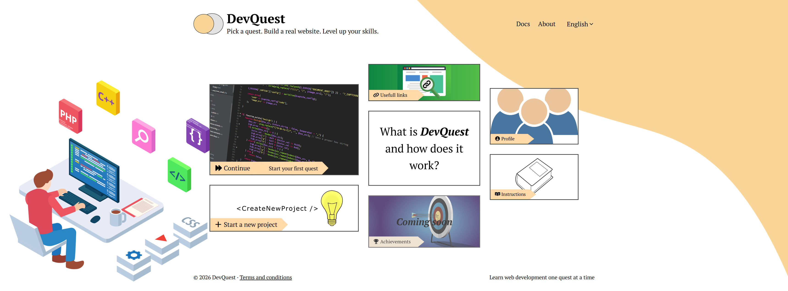
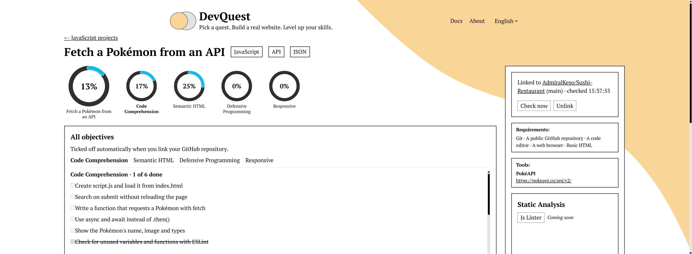
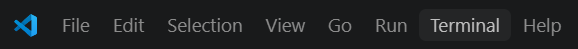
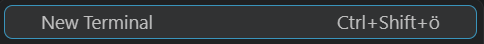

# DevQuest

Pick a quest. Build a real website. Level up your skills.

<div align="center">
  
  &nbsp;&nbsp;
  
</div>

DevQuest helps you learn web development by building real projects. You choose a goal, like a portfolio or a small app that uses an API. DevQuest gives you the steps, tips and links you need. You write the code in your own GitHub repository, and DevQuest ticks off each step as soon as it finds your code. I want you to have fun developing and giving you inspiration on the way for new projects to explore on your own. I try to cover the "basics" of what a recruiter might ask.

## What you need

Install these three programs first. They are all free.

1. **Node.js**: runs DevQuest on your computer. Download the **LTS** version from [nodejs.org](https://nodejs.org) and install it with the default settings.
2. **Git**: downloads DevQuest and saves your own projects. Download it from [git-scm.com](https://git-scm.com/downloads) and install it with the default settings.
3. **A code editor**, for example [Visual Studio Code](https://code.visualstudio.com).

You also need a free [GitHub](https://github.com) account for your own projects.

### Check that it worked

Open a terminal:

- **Windows:** press the Windows key, type `PowerShell` and press Enter.
- **Mac:** press Cmd + Space, type `Terminal` and press Enter.

Type these commands one at a time and press Enter after each one:

```bash
node --version
git --version
```

Each one should print a version number, like `v22.12.0`. If you see "not recognized" or "command not found", close the terminal, open a new one and try again. If it still doesn't work, install the program again.

## Setup (Do this once)

Type these commands in your terminal. In Visual Studio Code you can open one at the top: click **Terminal**, then **New Terminal**.





Type the commands one at a time. Press Enter after each one and wait until it's finished before you type the next.

**1. Download DevQuest:**

```bash
git clone https://github.com/AdmiralKeso/DevQuest.git
```

**2. Go into the DevQuest folder:**

```bash
cd DevQuest
```

**3. Install what DevQuest needs to run.** This can take a minute.

```bash
npm install
```

**4. Create the settings file.** It's a copy of `.env.example`, called `.env`.

On Windows (PowerShell):

```bash
copy .env.example .env
```

On Mac or Linux:

```bash
cp .env.example .env
```

**5. Start DevQuest:**

```bash
npm run dev
```

**6. Open DevQuest in your browser:** go to [http://localhost:5173](http://localhost:5173).

DevQuest keeps running as long as the terminal stays open.

### Starting DevQuest again later

Open a terminal and type:

```bash
cd DevQuest
npm run dev
```

Then go to [http://localhost:5173](http://localhost:5173) again.

## How to use DevQuest

1. **Choose a project.** Click "Start a new project" on the main menu and pick one.
2. **Read the project page.** It shows what you need, how to start, tips and helpful links.
3. **Make a public repository on GitHub** for your project and push your code to it.
4. **Link your repository.** Paste its address (like `https://github.com/your-name/your-project`) under "Link to project" and click the button.
5. **Write code and push it.** DevQuest checks your repository every 30 seconds and ticks off the steps it finds. Click "Check now" if you don't want to wait.

The rings at the top show your progress. Your started projects are listed under "In progress", and finished ones on your Profile.

Your repository must be **public**. DevQuest can't see private repositories.

## Projects

| Project | Language | Difficulty |
|---|---|---|
| Fetch a Pokémon from an API | JavaScript | Medium |

More projects are on the way.

## Problems?

- **`npm` or `node` is "not recognized":** Node.js isn't installed, or the terminal was open while you installed it. Close the terminal and open a new one.
- **"Port 5173 is in use":** DevQuest is probably already running in another terminal. Use that one, or stop it with Ctrl + C first.
- **My steps don't tick off:** check that your repository is public, that you pushed your code to GitHub, and that it's linked on the project page. Then click "Check now".
- **"Too many requests":** wait a few seconds and try again.

## For developers

DevQuest is built with React, Vite and Tailwind CSS, with a small Express API and a SQLite database.

- `npm run dev`: starts the website and the API
- `npm run build`: builds the website into `dist/`
- `npm run lint`: checks the code

Projects and their steps are in [`src/data/objectives.js`](src/data/objectives.js). There's a commented template above the project list to copy for a new project.

## Credits

- **Progress rings:** based on the [Progress Circle](https://www.figma.com/community/file/1666459251011120303/progress-circle) design from the Figma Community.
- **Images:** all images in DevQuest are from [Pixabay](https://pixabay.com).
